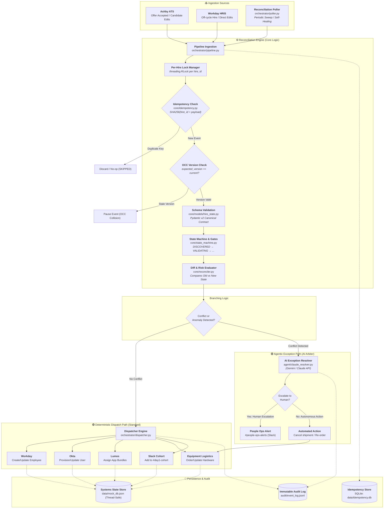

# 🚀 BetterUp Onboarding Automation & Reconciliation Engine

> **Take-Home Exercise — People Technology: AI Automation Engineer**  
> An event-driven reconciliation and synchronization engine tying together **Ashby**, **Workday**, **Okta**, **Lumos**, **Equipment Logistics**, and **Slack**, featuring **Google Gemini / Claude** as an agentic exception arbiter for policy conflicts.

### 📋 Primary Evaluator Deliverables
| Document | Purpose |
| :--- | :--- |
| 📄 **[`BUILD_NOTE.md`](file:///Users/arpit/Better-UP-AI-AUTOMATION/BUILD_NOTE.md)** | **Core Take-Home Write-up:** Slice A ranking vs. B/C, Stack discipline defense vs. low-code (n8n/Zapier), code snippets, prompt schemas, productionize roadmap, and AI tools disclosure (with real bug caught). |
| 🧪 **[`DEMO_RUN_LOG.md`](file:///Users/arpit/Better-UP-AI-AUTOMATION/DEMO_RUN_LOG.md)** | **Execution Proof:** 7 of 7 scenario run logs, before/after `mock_db.json` states, idempotency replay proof, and real `audit/event_log.jsonl` traces. |
| 🗺️ **[`SYSTEMS_FLOW_MAP.md`](file:///Users/arpit/Better-UP-AI-AUTOMATION/SYSTEMS_FLOW_MAP.md)** | **Architecture Diagrams:** High-level system map, sequence diagrams for concurrency/poller, state machine lifecycle, operational SLOs, and out-of-scope non-goals. |

---

## 📌 Executive Summary & Architecture

Employee onboarding spans multiple decoupled systems with no single source of truth:
* **Recruiting & Offers:** Ashby ATS
* **Core HRIS:** Workday
* **Identity & Access:** Okta & Lumos
* **Hardware Logistics:** IT Equipment Fulfillment
* **Communication & Cohorts:** Slack

When changes occur post-offer (start dates shift, addresses change mid-transit, or off-cycle hires bypass recruiting), traditional point-to-point webhooks fail. 

This engine implements **Slice A: Event-Driven Change Propagation & Reconciliation**, using deterministic logic for 90% of operations and invoking AI as an **agentic decision-maker only for edge-case conflicts**.

---

## 🗺️ System Flow Diagram



---

## 🔑 Key Engineering Concepts

### 1. Canonical State Contract (`HireState`)
* All incoming data from Ashby or Workday is normalized into a strictly validated Pydantic v2 `HireState` model.
* Enforces legal name sanitization, email verification, and stage-gate tracking. No connector ever mutates another connector's data directly.

### 2. Idempotency & Replay Protection
* Every event is fingerprinted using `SHA256(hire_id + event_type + sorted_payload)`.
* Backed by an indexed SQLite store (`data/idempotency.db`) with 30-day TTL.
* **Guarantees:** Webhook retries never duplicate Okta user accounts or double-order laptops.

### 3. Concurrency Protection & Optimistic Concurrency Control (OCC)
* **Per-Hire Mutex Locking (`LockManager`):** Webhooks arriving simultaneously for the same hire are queued and executed sequentially. Multiple different hires process in parallel without blocking.
* **OCC Verification:** Events specifying an `expected_version` detect stale data collisions before applying changes.
* **Thread-Safe Mock DB:** File I/O operations on `mock_db.json` are guarded by re-entrant locks.

### 4. Self-Healing Reconciliation Poller (Stuck/Lost Webhook Protection)
* What if Ashby's webhook server fails or the network drops a packet?
* The `ReconciliationPoller` (`orchestrator/poller.py`) runs periodic sweeps, diffing upstream Ashby and Workday data against the internal canonical database.
* Automatically provisions un-ingested candidates and heals silent field drift (e.g., date pushbacks made in ATS without a successful webhook).

### 5. Gemini / Claude as an Agentic Exception Arbiter
* AI is **not** used as a generic wrapper or for mundane field copying.
* Standard changes run through high-speed, deterministic code.
* AI is invoked **only when business rules conflict**:
  * Address changes when equipment status is already `SHIPPED` / `DELIVERED`.
  * Start dates moved to within 72 hours of Day 1.
  * Legal name discrepancies between background checks and ATS.
* Formulates a structured JSON remediation plan (e.g., intercept FedEx shipment, alert People Ops via Slack, or pause provisioning).

---

## 📂 Project Directory Structure

```
Better-UP-AI-AUTOMATION/
├── core/
│   ├── models/
│   │   ├── hire_state.py          # Canonical HireState & StageGates schemas (Pydantic v2)
│   │   └── events.py              # ChangeEvent envelope, EventType, and risk mappings
│   ├── state_machine.py           # Explicit state transitions & stage gate enforcement
│   ├── reconciler.py              # Pure diff engine & conflict detection rules
│   └── idempotency.py             # SQLite-backed SHA-256 idempotency store
│
├── connectors/
│   ├── base.py                    # Base connector with thread-safe mock_db access
│   ├── ashby.py                   # Ashby ATS API client & webhook emitter
│   ├── workday.py                 # Workday HRIS client (standard & off-cycle hires)
│   ├── okta.py                    # Okta user provisioning & email alias generator
│   ├── lumos.py                   # Lumos app access governance by department
│   ├── equipment.py               # Hardware ordering, shipment tracking, & cancellation
│   └── slack.py                   # Slack cohort channels, alerts, & direct messages
│
├── orchestrator/
│   ├── pipeline.py                # Main orchestration pipeline (Locking, OCC, Routing)
│   ├── dispatcher.py              # Downstream connector routing & gate completions
│   └── poller.py                  # Scheduled reconciliation sweep & self-healing engine
│
├── agent/
│   ├── claude_resolver.py         # Gemini/Claude API integration for conflict arbitration
│   └── prompts.py                 # Structured prompts enforcing JSON action schemas
│
├── audit/
│   └── event_log.py               # Immutable append-only JSONL audit trail
│
├── tests/
│   ├── scenarios/
│   │   ├── helpers.py             # Mock reset utilities and hire factories
│   │   ├── scenario_01_standard_hire.py
│   │   ├── scenario_02_start_date_change.py
│   │   ├── scenario_03_address_change_mid_ship.py
│   │   ├── scenario_04_off_cycle_hire.py
│   │   ├── scenario_05_name_mismatch.py
│   │   ├── scenario_06_concurrency_race.py
│   │   └── scenario_07_missed_webhook_recovery.py
│
├── data/
│   ├── mock_db.json               # Shared in-memory mock store across systems
│   └── idempotency.db             # SQLite database for deduplication
│
├── run_all_scenarios.py           # Master scenario test runner
├── SYSTEMS_FLOW_MAP.md            # Detailed visual workflow & sequence diagrams
├── requirements.txt               # Dependencies
└── .env.example                   # Environment variable template
```

---

## ⚡ Quickstart & Testing

### 1. Environment Setup

```bash
# Clone and enter the workspace
cd /Users/arpit/Better-UP-AI-AUTOMATION

# Create and activate a virtual environment
python3 -m venv venv
source venv/bin/activate

# Install dependencies
pip install -r requirements.txt

# Configure environment variables (optional: add your Gemini API key)
cp .env.example .env
```

### 2. Run the Full Test Suite (All 7 Scenarios)

```bash
python3 run_all_scenarios.py
```

**Expected Output:**
```
============================================================
  RESULTS SUMMARY
============================================================
  ✅ PASSED: 01 — Standard New Hire
  ✅ PASSED: 02 — Start Date Change
  ✅ PASSED: 03 — Address Changed After Ship
  ✅ PASSED: 04 — Off-Cycle Hire (Workday-Only)
  ✅ PASSED: 05 — Legal Name Mismatch
  ✅ PASSED: 06 — Concurrency Race & OCC
  ✅ PASSED: 07 — Missed Webhook Recovery (Poller)

  Total: 7 passed, 0 failed out of 7 scenarios
============================================================
```

### 3. Run Individual Scenarios

```bash
# Happy path: Standard Ashby offer -> Okta, Lumos, Laptop -> DAY1_READY
python3 tests/scenarios/scenario_01_standard_hire.py

# Mid-flight update: Start date pushed back -> Selective downstream sync
python3 tests/scenarios/scenario_02_start_date_change.py

# Policy conflict: Address change after laptop shipped -> AI Arbiter / People Ops alert
python3 tests/scenarios/scenario_03_address_change_mid_ship.py

# Multi-head hiring: Off-cycle hire created directly in Workday (no ATS record)
python3 tests/scenarios/scenario_04_off_cycle_hire.py

# Compliance: Legal name change -> Verification pause & People Ops DM
python3 tests/scenarios/scenario_05_name_mismatch.py

# Concurrency: 4 simultaneous threads mutate the same hire + OCC collision
python3 tests/scenarios/scenario_06_concurrency_race.py

# Self-Healing: Webhook dropped in transit -> Scheduled poller recovers state
python3 tests/scenarios/scenario_07_missed_webhook_recovery.py
```

---

## 🔍 Observability & State Inspection

### Inspect the Immutable Audit Trail
Every lifecycle state change and connector action is permanently recorded in JSONL format:
```bash
# Inspect the last 5 events
tail -5 audit/event_log.jsonl | python3 -m json.tool

# Filter audit history for a specific hire
grep "HIRE-S01" audit/event_log.jsonl
```

### Inspect the System State
View current mocked records across all systems:
```bash
# View all provisioned Okta accounts, hardware orders, and Slack notifications
cat data/mock_db.json | python3 -m json.tool
```

---

## 🛡️ Defending Key Technical Decisions (For Debrief)

1. **Why Slice A (Change Propagation & Event Reconciliation)?**  
   Validation (Slice B) and Exception Monitoring (Slice C) only report problems. Without a centralized reconciliation engine, People Ops is still forced to manually update 5 separate consoles every time a start date shifts or an off-cycle hire occurs.

2. **Why SQLite for Idempotency?**  
   Zero infrastructure overhead, local file persistence, ACID transactional safety (`INSERT OR IGNORE`), and sub-millisecond execution.

3. **Why Constrain AI to Conflicts Only?**  
   Language models should not perform deterministic data forwarding—they introduce latency, cost, and hallucination risks. Standard onboarding fields run through typed, deterministic Python logic. AI acts as an escalation arbiter when human judgment or cross-policy decisions are needed.
