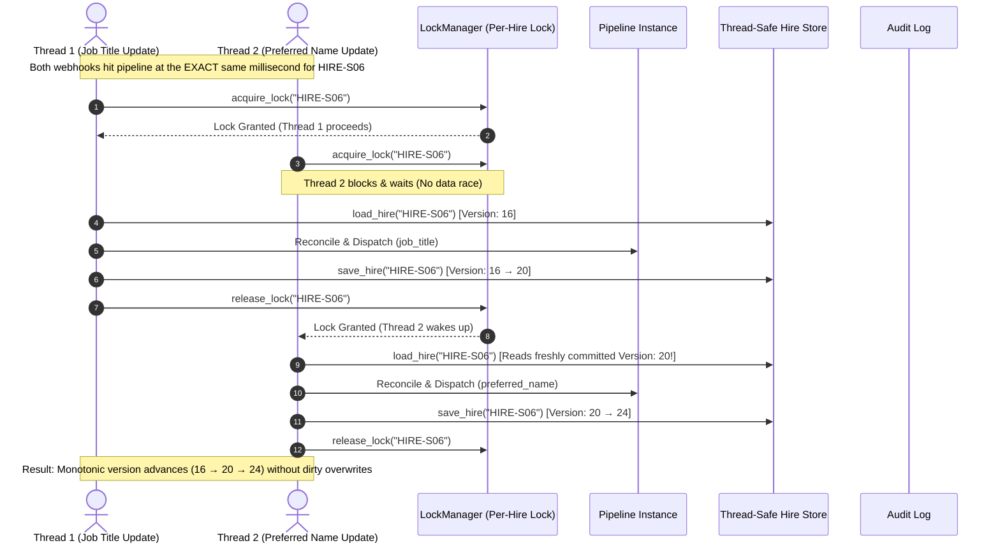
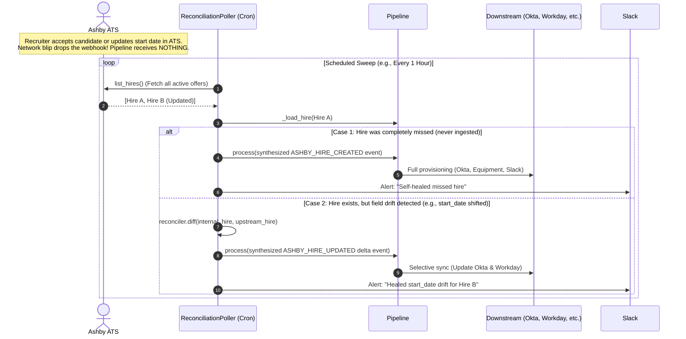
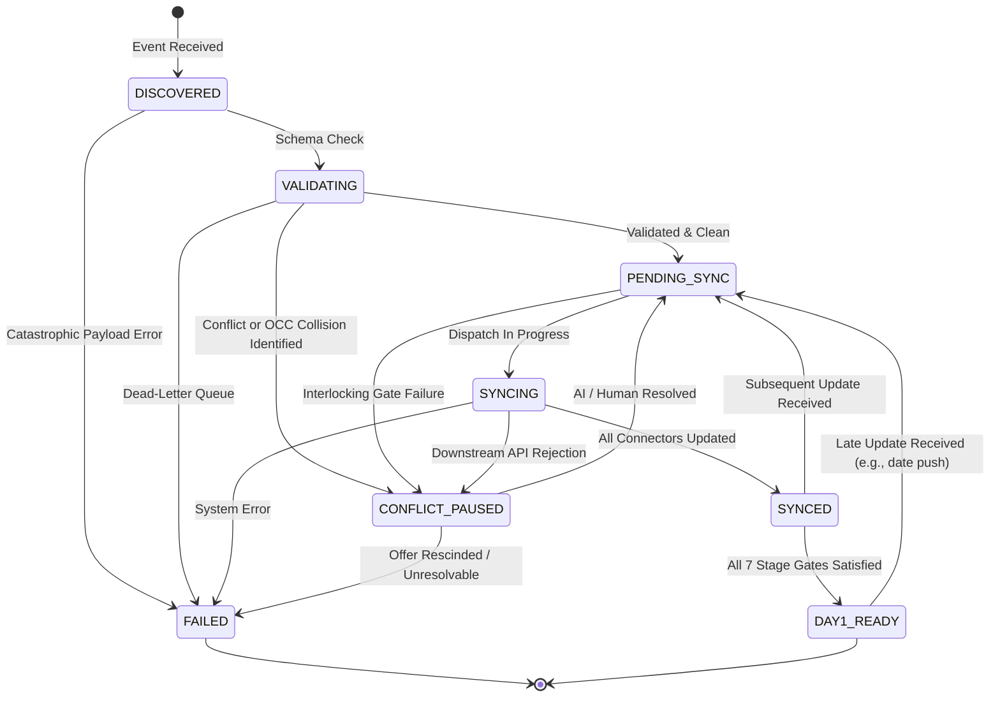

# 🗺️ BetterUp Onboarding Architecture & Systems Flow Map
## Slice A: Change Propagation & Event Reconciliation Engine

This document provides visual diagrams mapping how data moves across systems, how concurrent calls are serialized without race conditions, how dropped webhooks are self-healed, and how state transitions occur.

---

### 1. End-to-End System Architecture

```mermaid
flowchart TD
    subgraph Ingestion["📥 Ingestion Sources"]
        Ashby["<b>Ashby ATS</b><br/>Offer Accepted / Candidate Edits"]
        WorkdaySrc["<b>Workday HRIS</b><br/>Off-cycle Hire / Direct Edits"]
        Poller["<b>Reconciliation Poller</b><br/>orchestrator/poller.py<br/><i>Periodic Sweep / Self-Healing</i>"]
    end

    subgraph CoreEngine["⚙️ Reconciliation Engine (Core Logic)"]
        Ingest["<b>Pipeline Ingestion</b><br/>orchestrator/pipeline.py"]
        LockMgr["<b>Per-Hire Lock Manager</b><br/><i>threading.RLock per hire_id</i>"]
        OCCCheck{"<b>OCC Version Check</b><br/><i>expected_version == current?</i>"}
        IdemCheck{"<b>Idempotency Check</b><br/>core/idempotency.py<br/><i>SHA256(hire_id + payload)</i>"}
        SchemaVal["<b>Schema Validation</b><br/>core/models/hire_state.py<br/><i>Pydantic v2 Canonical Contract</i>"]
        Reconciler["<b>Diff & Risk Evaluator</b><br/>core/reconciler.py<br/><i>Compares Old vs New State</i>"]
        StateMachine["<b>State Machine & Gates</b><br/>core/state_machine.py<br/><i>DISCOVERED → VALIDATING → ...</i>"]
    end

    subgraph Branching{"Decision Point"}
        DiffCheck{"Conflict or<br/>High-Risk Anomaly?"}
    end

    subgraph StandardPath["🟢 Deterministic Dispatch Path"]
        Dispatcher["<b>Dispatcher Engine</b><br/>orchestrator/dispatcher.py"]
        WD["<b>Workday</b><br/>Create/Update Employee"]
        OK["<b>Okta</b><br/>Provision/Update User"]
        LU["<b>Lumos</b><br/>Assign App Bundles"]
        EQ["<b>Equipment Logistics</b><br/>Order/Update Hardware"]
        SL["<b>Slack Cohort</b><br/>Add to #day1-cohort"]
    end

    subgraph AIPath["🟣 Agentic Exception Path (LLM Resolver)"]
        Gemini["<b>AI Exception Resolver</b><br/>agent/claude_resolver.py<br/><i>(Gemini / Claude via API)</i>"]
        DecisionAction{"Escalate to<br/>Human?"}
        PeopleOpsAlert["<b>People Ops Alert</b><br/>#people-ops-alerts (Slack)"]
        AutoAction["<b>Automated Intervention</b><br/>Cancel shipment / Re-order"]
    end

    subgraph Persistence["💾 Audit & Storage"]
        AuditLog[("<b>Immutable Audit Log</b><br/>audit/event_log.jsonl")]
        IdemDB[("<b>Idempotency Store</b><br/>SQLite: data/idempotency.db")]
        MockDB[("<b>Systems State Store</b><br/>data/mock_db.json (Thread-Safe)")]
    end

    %% Wiring
    Ashby -->|Webhook Event| Ingest
    WorkdaySrc -->|Webhook Event| Ingest
    Poller -->|Synthesized Event on Drift| Ingest

    Ingest --> LockMgr
    LockMgr --> IdemCheck
    
    IdemCheck -->|Duplicate Key| SkipLog["Discard / No-op (SKIPPED)"]
    IdemCheck -->|New Event| OCCCheck

    OCCCheck -->|Stale Version Detected| OCCPause["Pause Event (OCC Collision)"]
    OCCCheck -->|Version Valid| SchemaVal
    
    SchemaVal --> StateMachine
    StateMachine --> Reconciler
    Reconciler --> DiffCheck

    DiffCheck -->|No Conflict / Standard Change| Dispatcher
    DiffCheck -->|Conflict Detected<br/>e.g. Address changed post-ship| Gemini

    Dispatcher --> WD
    Dispatcher --> OK
    Dispatcher --> LU
    Dispatcher --> EQ
    Dispatcher --> SL

    Gemini --> DecisionAction
    DecisionAction -->|Yes: Legal mismatch / high risk| PeopleOpsAlert
    DecisionAction -->|No: Actionable rule| AutoAction
    AutoAction --> EQ

    %% Storage hooks
    Dispatcher -.-> AuditLog
    Gemini -.-> AuditLog
    OCCPause -.-> AuditLog
    Ingest -.-> IdemDB
    WD & OK & LU & EQ & SL -.-> MockDB
```

---

### 2. Scenario 06: Concurrent Webhooks & OCC Flow



---

### 3. Scenario 07: Missed Webhook Recovery via Reconciliation Poller



---

### 4. State Machine Lifecycle (`HireState`)



---

### 5. Operational Boundaries, Freshness SLOs & Out-of-Scope Non-Goals

#### A. Expected Volume & Throughput Thresholds
* **Annual Hiring Target:** ~1,200 to 2,500 hires/year (~50–100 hires/week during peak cohort cycles).
* **Peak Event Burst:** Up to 100 webhook events/hour (Friday offer acceptances or Monday morning start date adjustments).
* **Concurrency Ceiling:** Per-hire mutex ensures sequential execution per employee, with up to 50 simultaneous workers processing separate hires in parallel.

#### B. Freshness Service Level Objectives (SLOs)
| Operational Metric | Target SLO | Maximum Threshold | Mitigation on Breach |
| :--- | :--- | :--- | :--- |
| **Real-time Webhook Ingestion Latency** | **< 3 seconds** | 10 seconds | Downstream retry with exponential backoff |
| **End-to-End Provisioning Propagation** | **< 30 seconds** | 60 seconds | Paged to People Ops Slack alert channel |
| **Stuck/Dropped Webhook Healing (Poller)**| **< 1 hour** | 4 hours | Scheduled poller sweep auto-heals drift |
| **Hardware Procurement Gate** | **T-7 business days** | T-5 business days | Immediate AI escalation to IT logistics |
| **Identity Provisioning Gate** | **T-3 business days** | T-1 business day | Okta provisioning auto-triggered |

#### C. Explicit Out-of-Scope Non-Goals
1. **Payroll Calculation & Tax Withholding:**  
   * *Out of Scope:* While Workday worker records are created and synced, tax jurisdiction setup, direct deposit banking, and payroll ledger execution are strictly managed by Finance/Payroll within Workday and are **not** orchestrated by this engine.
2. **Hardware Vendor Warehousing ERP:**  
   * *Out of Scope:* The engine sends dispatch and cancellation directives to the hardware connector (`EquipmentConnector`), but internal warehouse inventory restocking, supply chain logistics, and device procurement contracts are handled out-of-band by IT Operations.
3. **Ongoing Performance & Compensation Reviews:**  
   * *Out of Scope:* This engine's domain boundary is strictly the **Pre-Hire through Day-1 Orientation lifecycle** (`DISCOVERED` to `DAY1_READY`). Once Day 1 commences, employee lifecycle events (promotions, performance management in Lattice) are decoupled.
